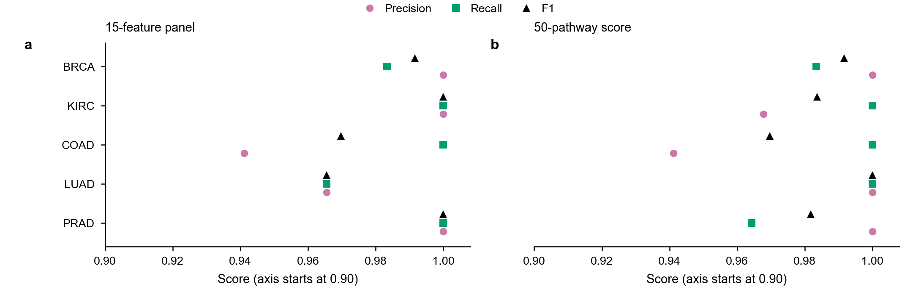
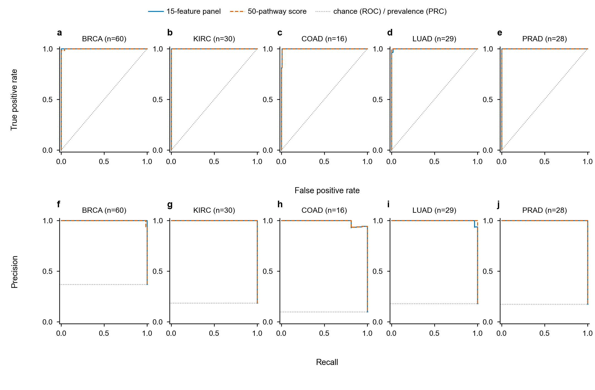
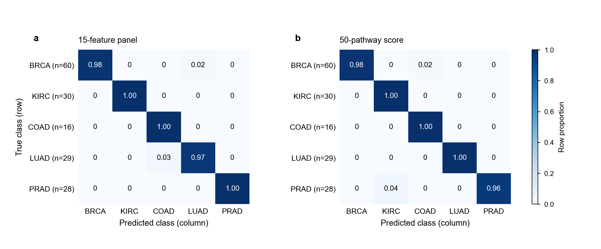

---
editor_options:
  markdown:
    wrap: sentence
---

# Model Performance Report

## Overview

This report evaluates the models used by `cancerRC`.
The Full-Matrix Multinomial Classifier used all 801 samples for its refit and has no independent test set yet.
The 15-Feature Panel Classifier and the 50-Pathway-Score Classifier were evaluated on the fixed-seed stratified 80/20 split.

The test set contains 163 samples.
The class order is `BRCA`, `KIRC`, `COAD`, `LUAD`, and `PRAD`.
The seed is `20261115`.

## Summary

| Model | Macro-F1 (primary) | Accuracy | Balanced accuracy | Macro AUROC (OvR) | Macro AUPRC (OvR; AP) | Test size |
|:----------|----------:|----------:|----------:|----------:|----------:|----------:|
| Full-Matrix Multinomial Classifier | Not available | Not available | Not available | Not available | Not available | No independent test |
| 15-Feature Panel Classifier | 0.9854 | 0.9877 | 0.9898 | 0.9996 | 0.9972 | 163 |
| 50-Pathway-Score Classifier | 0.9853 | 0.9877 | 0.9895 | 0.9996 | 0.9974 | 163 |

Macro-F1 is the primary metric because it assigns equal weight to each class despite the unequal test-set class sizes; it exposes poor performance on smaller classes that overall accuracy could obscure.
It is the unweighted mean of the five class-specific F1 scores, not the F1 of macro-averaged precision and recall.
Accuracy and balanced accuracy are complementary summaries.

## Full-Matrix Multinomial Classifier

The Full-Matrix Multinomial Classifier used in the package is a full-data refit on 801 samples.
It has no independent test set.
A separate section is reserved for the original full-matrix model evaluation; its source results have not yet been supplied.

## 15-Feature Panel Classifier

- Macro-F1 (primary): `0.9854`.
- Accuracy: `0.9877`.
- Balanced accuracy: `0.9898`.
- Macro AUROC: `0.9996`.
- Macro AUPRC: `0.9972`.
- test set size: `163`.

## 50-Pathway-Score Classifier

- Macro-F1 (primary): `0.9853`.
- Accuracy: `0.9877`.
- Balanced accuracy: `0.9895`.
- Macro AUROC: `0.9996`.
- Macro AUPRC: `0.9974`.
- test set size: `163`.

## Class-specific evaluation

The following tables report precision, recall and F1 using the class with the highest predicted probability, and one-vs-rest (OvR) AUROC and AUPRC using the corresponding class probabilities.

### 15-Feature Panel Classifier

| Class | Support | Precision | Recall |     F1 | AUROC (OvR) | AUPRC (AP, OvR) |
|:------|--------:|----------:|-------:|-------:|------------:|----------------:|
| BRCA  |      60 |    1.0000 | 0.9833 | 0.9916 |      1.0000 |          1.0000 |
| KIRC  |      30 |    1.0000 | 1.0000 | 1.0000 |      1.0000 |          1.0000 |
| COAD  |      16 |    0.9412 | 1.0000 | 0.9697 |      0.9987 |          0.9883 |
| LUAD  |      29 |    0.9655 | 0.9655 | 0.9655 |      0.9995 |          0.9978 |
| PRAD  |      28 |    1.0000 | 1.0000 | 1.0000 |      1.0000 |          1.0000 |

### 50-Pathway-Score Classifier

| Class | Support | Precision | Recall |     F1 | AUROC (OvR) | AUPRC (AP, OvR) |
|:------|--------:|----------:|-------:|-------:|------------:|----------------:|
| BRCA  |      60 |    1.0000 | 0.9833 | 0.9916 |      0.9994 |          0.9990 |
| KIRC  |      30 |    0.9677 | 1.0000 | 0.9836 |      1.0000 |          1.0000 |
| COAD  |      16 |    0.9412 | 1.0000 | 0.9697 |      0.9987 |          0.9883 |
| LUAD  |      29 |    1.0000 | 1.0000 | 1.0000 |      1.0000 |          1.0000 |
| PRAD  |      28 |    1.0000 | 0.9643 | 0.9818 |      1.0000 |          1.0000 |

The same 163 test samples were evaluated by both models.
Support is the number of held-out samples of the true class.
Values are rounded to four decimal places.
All values are point estimates from one split; no error bars, inferential tests or multiplicity corrections are reported.
AUROC, area under the receiver operating characteristic curve; AUPRC, area under the precision-recall curve, calculated here as average precision (AP); OvR, one versus the other four classes.
Scores of 1.0000 are rounded and do not establish perfect generalization.

## Performance metrics, ROC, and PRC

**Class-specific classification metrics.** (a) The 15-feature panel classifier and (b) the 50-pathway-score classifier.
The x-axis shows the metric value and the y-axis the true class; point shapes distinguish precision, recall and F1.
The x-axis is truncated to display differences near one.

**Class-specific one-vs-rest ROC and precision-recall curves.** (a–e) ROC curves for BRCA, KIRC, COAD, LUAD and PRAD, respectively.
(f–j) Precision-recall curves for the same classes.
Line style distinguishes the two models; the dotted reference is the chance diagonal for ROC and the class prevalence for precision-recall.

**Row-normalized confusion matrices.** (a) The 15-feature panel classifier and (b) the 50-pathway-score classifier.
Rows represent true classes and columns predicted classes; each cell is divided by its true-class support, so rows sum to one before rounding.
Parentheses show the number of held-out samples per true class; each model was evaluated on 163 samples.
Cell values are rounded; no uncertainty intervals or statistical tests are shown.

## Metric definitions and reproducibility

For each class, precision = TP/(TP + FP), recall = TP/(TP + FN), and F1 = 2TP/(2TP + FP + FN), where TP, FP and FN are one-vs-rest true positives, false positives and false negatives.
Macro-F1, macro AUROC and macro AUPRC are unweighted means of the corresponding five class-level scores.
Balanced accuracy is the mean class recall.
AUROC is the trapezoidal area of the empirical OvR ROC; it was independently cross-checked against `pROC`.
AUPRC in this report is **average precision**, calculated as the sum of precision multiplied by the increase in recall at each distinct score threshold; it is not trapezoidal PR area.
Tied scores are grouped.
A PR curve's no-skill baseline equals the prevalence of that class in the test set.

The results were recalculated from the frozen panel and pathway coefficients and their held-out inputs, with `scripts/40_performance_metrics.R` in the project repository; its confusion counts agree exactly with the respective frozen model records.
Metric tables and curve points are generated under `report/figures/`, and the figure source and contract are under `report/figures/performance/`.
The 163 samples are the held-out portion of the fixed-seed fallback split, not an external cohort.

## Reference evaluation of the original full-matrix model

This section is reserved for the earlier full-matrix model evaluation.
It is not identical to the full-data refit used in `predict_main()`.

| Metric | Value |
|:-----------------------------------|:-----------------------------------|
| AUROC | To be added from the original full-matrix model evaluation |
| AUPRC | To be added from the original full-matrix model evaluation |
| Accuracy | To be added from the original full-matrix model evaluation |
| Balanced accuracy | To be added from the original full-matrix model evaluation |
| Test size | To be confirmed from the evaluation record |
| Aggregate ROC figure | To be added |
| Aggregate precision-recall figure | To be added |

## Limitations

The panel and pathway holdout split is a fixed-seed fallback split.
It is distinct from the original full-matrix model evaluation split.
The same held-out set is used for both models, and results from one internal split may be optimistic and do not measure external generalization.

Class sizes range from 16 to 60; performance uncertainty is not quantified here.
If the holdout is repeatedly inspected during model or feature choices, it can no longer serve as an untouched final test.

The reported metrics are not clinical validation.
The classifiers are not diagnostic tools and are not validated for unknown tumor classes.
